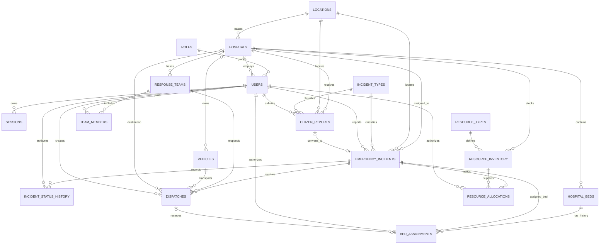

# Team Contract and Shared Project Definitions

**Project:** Smart Emergency Response & Resource Allocation for Hospitals
**Course:** DBMS Experiential Learning, Level 3
**Team:** 2 members
**Repository:** `Varchas-Shetty/smart-emergency-response` (default branch `main`)

This contract defines the agreed system boundaries, canonical database names, ownership, and integration rules. Implementation is staged on feature branches and merged by pull request.

## Scope and architecture

Build a local academic simulation using synthetic data. It records emergency reports, manages incidents, shows hospital capacity and stock, and coordinates response teams, vehicles, beds, and dispatch. It is not a production medical system, does not store real patient data, and does not provide clinically validated triage or recommendations.

Use one Next.js App Router application with TypeScript, React, and Tailwind CSS. Server Components perform database-backed reads; authenticated Server Actions validate input and authorization before executing direct parameterized PostgreSQL commands or MongoDB operations. Use PostgreSQL as the source of truth for structured operational records and transactions. Use MongoDB for supplementary flexible incident events. Stack: official `pg` and MongoDB Node.js drivers, SQL migrations, Zod, secure database-backed sessions, password hashing, and HTTP-only cookies. Credentials are environment variables; no paid service is mandatory.

Flow: browser -> Next.js UI -> Server Component/Server Action -> validation and RBAC -> PostgreSQL and, for events, transactional outbox -> MongoDB publisher. Internal database operations do not use REST API route handlers.

## Roles and hospital access

- `ADMIN` users may access all hospitals. Their `users.hospital_id` is `NULL`.
- `HOSPITAL_STAFF` users must have exactly one assigned hospital, referenced by non-null `users.hospital_id` to `hospitals.hospital_id`.
- `users.role_id` references `roles.role_id`. A PostgreSQL constraint trigger (or equivalent migration-enforced database rule) validates the cross-table invariant: `ADMIN` has no hospital and `HOSPITAL_STAFF` has one. The service validates it before writes as well.
- Every API is deny-by-default. A staff query or mutation is scoped to the actor's `hospital_id`; the server derives it from the authenticated user, never from client-supplied scope. Admin may select any hospital. The UI does not grant access.
- Hospital-owned rows are `hospitals`, `hospital_beds`, `resource_inventory`, and `emergency_incidents` (nullable `hospital_id` only for an incident awaiting Admin assignment). A report has a required `hospital_id` indicating the receiving hospital. Its linked incident must use the same hospital. Bed assignments derive their hospital through `hospital_beds`.

## Relational schema (canonical names)

All primary keys are generated identity integers except `event_outbox.event_id`, a UUID. Timestamps use `timestamptz`; coordinates use `numeric`; status values are constrained. `created_at`/`updated_at` are included on mutable operational rows. FK delete rules preserve audit history (`RESTRICT`/`SET NULL` where appropriate); append-only records are not cascade-deleted.

| Table | Canonical columns and rules |
|---|---|
| `roles` | `role_id` PK, `role_name` unique (`ADMIN`, `HOSPITAL_STAFF`), `description` |
| `hospitals` | `hospital_id` PK, unique `hospital_code`, `hospital_name`, `location_id` FK, contact fields, `is_active` |
| `users` | `user_id` PK, `role_id` FK, nullable `hospital_id` FK, unique `username`/`email`, `password_hash`, `is_active`, timestamps; role/hospital invariant above |
| `sessions` | `session_id` PK, `user_id` FK, unique `token_hash`, `expires_at`, `created_at`; no raw session token at rest |
| `locations` | `location_id` PK, `address`, `locality`, checked `latitude`, `longitude` |
| `incident_types` | `incident_type_id` PK, unique `type_name`, `description`, `is_active` |
| `citizen_reports` | `report_id` PK, `hospital_id` FK, `reported_by_user_id` FK, `incident_type_id` FK, `location_id` FK, `description`, `reported_at`, `report_status`, nullable `incident_id` FK |
| `emergency_incidents` | `incident_id` PK, nullable `hospital_id` FK, `incident_type_id` FK, `reported_by_user_id` FK, `location_id` FK, `summary`, `occurred_at`, `severity`, `priority_score`, `incident_status`, timestamps |
| `incident_status_history` | `history_id` PK, `incident_id` FK, nullable `old_status`, `new_status`, `actor_user_id` FK, `note`, `changed_at`; trigger-written, append-only |
| `hospital_beds` | `bed_id` PK, `hospital_id` FK, unique `(hospital_id, bed_code)`, `bed_type`, `bed_status`, timestamps |
| `bed_assignments` | `bed_assignment_id` PK, `bed_id` FK, `incident_id` FK, nullable `dispatch_id` FK, `assigned_by_user_id` FK, `released_by_user_id` nullable FK, `assignment_status`, `reserved_at`, `occupied_at`, `released_at`, `release_reason`; retained history |
| `resource_types` | `resource_type_id` PK, unique `resource_name`, `unit`, `description` |
| `resource_inventory` | `inventory_id` PK, `hospital_id` FK, `resource_type_id` FK, `quantity_on_hand`, `quantity_reserved`, `updated_at`, unique `(hospital_id, resource_type_id)`; checks `quantity_on_hand >= 0`, `0 <= quantity_reserved <= quantity_on_hand`; available = on hand - reserved |
| `response_teams` | `team_id` PK, nullable `hospital_id` FK (home hospital), `team_name`, `team_status`, `current_location_id` FK |
| `team_members` | `team_member_id` PK, `team_id` FK, `user_id` FK, `member_role`, `joined_at`, nullable `left_at`; one active membership per user/team |
| `vehicles` | `vehicle_id` PK, nullable `hospital_id` FK, unique `registration_number`, `vehicle_type`, `vehicle_status`, `current_location_id` FK |
| `resource_allocations` | `allocation_id` PK, `incident_id` FK, `inventory_id` FK, `allocated_by_user_id` FK, positive `quantity`, `allocation_status`, `reserved_at`, nullable `released_at`/`consumed_at`; audit lifecycle below |
| `dispatches` | `dispatch_id` PK, `incident_id` FK, `team_id` FK, `vehicle_id` FK, `created_by_user_id` FK, nullable `hospital_id` FK, timestamps `created_at`/`dispatched_at`/`arrived_at`/`completed_at`, `dispatch_status`; bed linked via `bed_assignments` |
| `event_outbox` | `event_id` UUID PK, `aggregate_type`, `aggregate_id`, `event_type`, `payload` JSONB, `outbox_status`, `attempt_count`, `available_at`, nullable `locked_at`/`published_at`/`last_error`, `created_at` |

### Entity relationships and cardinality

- One role has many users; an admin has no hospital, while each hospital staff user references exactly one hospital.
- One hospital has many staff users, reports, assigned incidents, beds, inventory rows, home teams, vehicles, and destination dispatches. An incident may await Admin assignment; until assigned it is visible only to Admin, and once assigned it belongs to one hospital.
- One report belongs to one hospital and may link to zero or one incident. One incident may consolidate many reports. The linked report and incident must have the same `hospital_id`.
- One incident type classifies many reports and incidents. One location may be referenced by many reports, incidents, hospitals, teams, and vehicles.
- One incident has many status-history rows, bed-assignment history rows, resource allocations, dispatch attempts, and outbox events.
- One hospital contains many beds and inventory rows; each inventory row references one resource type.
- One bed has many historical assignment rows but at most one active (`RESERVED` or `OCCUPIED`) assignment. One incident has at most one active bed assignment.
- One team has many membership rows and dispatches over time. A vehicle and team can each be in at most one active dispatch.
- An inventory row has many allocations. Each allocation references one incident and inventory row; quantity is tracked per allocation.
- One dispatch has one incident, one team, and one vehicle; destination hospital is optional. It may reference one bed assignment through nullable `bed_assignments.dispatch_id`; an assignment may exist before a dispatch is created, so that FK is nullable.
- A user creates many reports, incidents, status-history rows, bed assignments, allocations, dispatches, and sessions.

## ER diagram (Mermaid)

`event_outbox` is an operational integration table keyed by `event_id`; its `aggregate_type`/`aggregate_id` pair refers to the originating relational entity. MongoDB IDs are UUID event IDs and are not additional relational foreign keys.

## Transactional invariants and database concepts

- Use `NOT NULL`, `CHECK`, FK, and unique constraints for required data, statuses, coordinates, quantities, account identity, bed codes, and hospital/resource pairs.
- Allocation, bed assignment, and dispatch services use PostgreSQL transactions and lock relevant inventory, bed, incident, team, and vehicle rows with `SELECT ... FOR UPDATE` before checking availability and writing changes.
- Partial unique indexes permit one active bed assignment per bed, incident, and dispatch; one active dispatch per incident, team, and vehicle. Define active as `RESERVED`/`OCCUPIED` for assignments and `QUEUED`/`DISPATCHED`/`EN_ROUTE`/`ON_SCENE`/`TRANSPORTING` for dispatches.
- Keep inventory count checks in the database and perform on-hand/reserved updates with allocation state transitions in the same transaction. Any failed check or later insert rolls back all writes.
- Use trigger-written `incident_status_history`, the `event_outbox` retry mechanism, a reporting view, a guarded SQL function for allocation or dispatch, and indexes supported by query-plan examples. MongoDB aggregation provides flexible event timelines and counts. Together these cover transactions, triggers, functions, views, indexes, and NoSQL aggregation.

## Statuses and permitted transitions

The database constrains the enumerated values; service logic and conditional SQL updates enforce transitions. Any transition not listed is rejected with a conflict response. Terminal states do not reopen; create a new record for a new attempt.

| Entity | Status values | Allowed transitions |
|---|---|---|
| `citizen_reports.report_status` | `RECEIVED`, `REVIEWED`, `CONVERTED`, `REJECTED`, `CLOSED` | `RECEIVED -> REVIEWED, REJECTED`; `REVIEWED -> CONVERTED, REJECTED`; `CONVERTED -> CLOSED`; `REJECTED -> CLOSED`; `CLOSED` terminal |
| `emergency_incidents.incident_status` | `NEW`, `VALIDATED`, `PRIORITIZED`, `ASSIGNED`, `IN_PROGRESS`, `RESOLVED`, `CLOSED`, `CANCELLED` | `NEW -> VALIDATED, CANCELLED`; `VALIDATED -> PRIORITIZED, CANCELLED`; `PRIORITIZED -> ASSIGNED, CANCELLED`; `ASSIGNED -> IN_PROGRESS, CANCELLED`; `IN_PROGRESS -> RESOLVED, CANCELLED`; `RESOLVED -> CLOSED`; `CLOSED`, `CANCELLED` terminal |
| `hospital_beds.bed_status` | `AVAILABLE`, `RESERVED`, `OCCUPIED`, `OUT_OF_SERVICE` | `AVAILABLE -> OUT_OF_SERVICE`; `OUT_OF_SERVICE -> AVAILABLE`; assignment transaction sets `AVAILABLE -> RESERVED`; arrival sets `RESERVED -> OCCUPIED`; release sets `RESERVED/OCCUPIED -> AVAILABLE` unless explicitly taken out of service |
| `bed_assignments.assignment_status` | `RESERVED`, `OCCUPIED`, `RELEASED`, `CANCELLED` | `RESERVED -> OCCUPIED, RELEASED, CANCELLED`; `OCCUPIED -> RELEASED`; terminal `RELEASED`, `CANCELLED` |
| `resource_allocations.allocation_status` | `RESERVED`, `RELEASED`, `CONSUMED` | Initial reserve creates `RESERVED`; `RESERVED -> RELEASED` or `CONSUMED`; terminal `RELEASED`, `CONSUMED` |
| `dispatches.dispatch_status` | `QUEUED`, `DISPATCHED`, `EN_ROUTE`, `ON_SCENE`, `TRANSPORTING`, `COMPLETED`, `CANCELLED` | `QUEUED -> DISPATCHED, CANCELLED`; `DISPATCHED -> EN_ROUTE, CANCELLED`; `EN_ROUTE -> ON_SCENE, CANCELLED`; `ON_SCENE -> TRANSPORTING, COMPLETED, CANCELLED`; `TRANSPORTING -> COMPLETED, CANCELLED`; terminal `COMPLETED`, `CANCELLED` |
| `response_teams.team_status` | `AVAILABLE`, `DISPATCHED`, `OFF_DUTY` | `AVAILABLE -> DISPATCHED, OFF_DUTY`; `DISPATCHED -> AVAILABLE, OFF_DUTY`; `OFF_DUTY -> AVAILABLE` |
| `vehicles.vehicle_status` | `AVAILABLE`, `DISPATCHED`, `MAINTENANCE` | `AVAILABLE -> DISPATCHED, MAINTENANCE`; `DISPATCHED -> AVAILABLE, MAINTENANCE`; `MAINTENANCE -> AVAILABLE` |
| `event_outbox.outbox_status` | `PENDING`, `PUBLISHED`, `FAILED` | `PENDING -> PUBLISHED`; `PENDING -> FAILED` after retry policy is exhausted; an operator may explicitly requeue `FAILED -> PENDING` |

### Inventory and allocation lifecycle

`resource_inventory.quantity_on_hand` is the physical count not yet consumed. `quantity_reserved` is the subset temporarily committed to active allocations. Available quantity is `quantity_on_hand - quantity_reserved`; both counts are integer units in the resource type's declared `unit`, never floating-point. The constraint requires `0 <= quantity_reserved <= quantity_on_hand`.

- **Reserve:** lock the inventory row, require available quantity >= request, add the requested amount to `quantity_reserved`, and insert a `resource_allocations` row in `RESERVED` in one transaction.
- **Release:** only a `RESERVED` allocation may be released. Subtract its quantity from `quantity_reserved`, set `RELEASED` and `released_at`, retain the row.
- **Consume:** only a `RESERVED` allocation may be consumed. Subtract quantity from both `quantity_reserved` and `quantity_on_hand`, set `CONSUMED` and `consumed_at`, retain the row.
- Repeated release/consume is rejected; no negative stock is possible. Each operation validates the actor's hospital access to `resource_inventory.hospital_id` and incident access.

## Secure status-trigger attribution

All status changes run in a transaction on one checked-out PostgreSQL connection. After authenticating the actor and before any status mutation, the server sets transaction-local context with a bound parameter, for example `SELECT set_config('app.actor_user_id', $1, true)`. The value is the authenticated `users.user_id`, never a request-body field. The third argument `true` makes it local to the transaction and prevents connection-pool leakage.

The `AFTER INSERT OR UPDATE OF incident_status` trigger reads `current_setting('app.actor_user_id', true)`, rejects a missing/invalid actor, and inserts `old_status` (null on first insert), `new_status`, `actor_user_id`, and timestamp into `incident_status_history`. The application database role has no direct insert/update/delete permission on the history table; the trigger function is narrowly privileged and validates that the actor exists and is active. Status writes outside a transaction with actor context fail. Trigger function is installed in migration `005_audit_outbox.sql` and is tested for correct actor attribution and missing-context rejection.

## PostgreSQL outbox and MongoDB publishing

Every committed operation requiring a Mongo timeline event inserts an `event_outbox` row in the same PostgreSQL transaction as the incident/dispatch/allocation/status change. A worker claims pending rows with `FOR UPDATE SKIP LOCKED`, a short lease, and bounded batches; it publishes to MongoDB `incident_events` using `event_id` as unique idempotency key, then marks the outbox row `PUBLISHED`. Failed publishes increment `attempt_count`, store bounded `last_error`, and move `available_at` using exponential backoff with jitter. After the configured retry limit, status becomes `FAILED` for operator review/requeue. Expired leases are reclaimable. Duplicate delivery is safe because Mongo has a unique index on `eventId` and upserts idempotently. Monitor pending age and failed count. No cross-database atomicity is claimed; PostgreSQL remains authoritative and delayed events are visible as eventual timeline updates.

Mongo database: `emergency_ops`; collection: `incident_events`. Documents contain `eventId` UUID, `incidentId`, `eventType`, `occurredAt`, `actorUserId`, `source`, `summary`, and flexible synthetic `details`. Index unique `{eventId: 1}` and `{incidentId: 1, occurredAt: -1}`. Timeline and count reports use aggregation pipelines.

## Historical REST contract (superseded)

The route table below records the original design contract for traceability only; those handlers have been removed. The current equivalent workflows execute in authenticated Server Actions and server-side reads, as described in the architecture above. Keep the same Zod validation, parameterized SQL, hospital authorization, and transaction invariants.

| Method and route | Purpose and scope |
|---|---|
| `POST /api/auth/login`, `POST /api/auth/logout`, `GET /api/auth/me` | Public login; session lifecycle; current authenticated user |
| `GET/POST /api/users` | Admin only; set `hospitalId` only for `HOSPITAL_STAFF` |
| `GET/POST /api/hospitals` | Admin sees/creates all; staff sees only own hospital and cannot change scope |
| `GET/POST /api/reports` | Staff report belongs to own hospital; Admin may choose hospital |
| `GET/PATCH /api/reports/:reportId` | Admin all; staff only matching `hospital_id`; PATCH advances `RECEIVED -> REVIEWED/REJECTED`, `REVIEWED -> REJECTED`, or closes a converted/rejected report |
| `POST /api/reports/:reportId/convert` | Admin or staff authorized for report's hospital; only a `REVIEWED` report can convert; transaction creates/links `emergency_incidents`, sets same `hospital_id`, changes report to `CONVERTED`, and writes audit/outbox records |
| `GET/POST /api/incidents`, `GET/PATCH /api/incidents/:incidentId` | Admin all including unassigned; staff only own `hospital_id`; only Admin can assign an unassigned incident |
| `GET /api/incidents/:incidentId/history` | Scope-check incident; return relational history plus available Mongo events |
| `GET/POST /api/hospitals/:hospitalId/beds`, `PATCH /api/beds/:bedId/status` | Admin any; staff only own hospital |
| `POST /api/incidents/:incidentId/bed-assignments` | Create `RESERVED` assignment with bed from authorized hospital; actor derived from session |
| `PATCH /api/bed-assignments/:bedAssignmentId` | Advance to `OCCUPIED`, `RELEASED`, or `CANCELLED` using legal transition and bed-state transaction |
| `GET/POST /api/hospitals/:hospitalId/resources` | Admin any; staff own hospital; receive stock and inspect availability |
| `POST /api/incidents/:incidentId/allocations` | Reserve available stock atomically for an authorized hospital |
| `PATCH /api/allocations/:allocationId` | `RESERVED -> RELEASED` or `CONSUMED`, only once |
| `GET/POST /api/teams`, `GET/POST /api/vehicles` | Admin any; staff scoped to own hospital; unassigned teams/vehicles are Admin-only |
| `POST /api/incidents/:incidentId/dispatches` | Create `QUEUED` dispatch and reserve available team/vehicle and optional `bedId` in one transaction; when a bed is selected, create `bed_assignments` with that `dispatch_id`; actor/hospital permissions enforced |
| `PATCH /api/dispatches/:dispatchId` | Advance dispatch status only through allowed transition; release team/vehicle and optionally bed at terminal state |
| `GET /api/dashboard/summary`, `GET /api/reports/analytics` | Admin all-hospital aggregates; staff aggregates scoped to own hospital |

Current Server Actions compare session hospital, target record hospital, and incident hospital inside the transaction to avoid authorization gaps; server-rendered reads scope records to the actor's hospital.

## Database, file, and team responsibility matrix

| Work area | Member A: V Sai Sri Saketh (PES2UG24CS602) | Member B: Varchas (PES2UG24CS575) |
|---|---|---|
| Shared foundation | Owns single Next.js setup, app shell, global error/response conventions, environment validation, PostgreSQL/Mongo connection lifecycle, migration runner scaffolding | Reviews integration interfaces; supplies domain requirements |
| Authentication and identity | Owns `roles`, `users`, `sessions`, password hashing, login/logout, hospital-role invariant, RBAC helpers | Defines hospital access expectations; reviews authorization coverage |
| Incident management | Owns `locations`, `incident_types`, `citizen_reports`, `emergency_incidents`, `incident_status_history`, report conversion, incident APIs/pages | Reviews conversion hospital scope and event requirements |
| Hospital operations | Reviews shared contract/migrations | Owns `hospitals`, `hospital_beds`, `bed_assignments`, bed APIs/pages and hospital management |
| Resources and dispatch | Reviews allocation/dispatch transaction contract | Owns `resource_types`, `resource_inventory`, `resource_allocations`, `response_teams`, `team_members`, `vehicles`, `dispatches`, APIs/pages |
| Mongo and outbox | Owns PostgreSQL `event_outbox` base table and shared publisher interface with A foundation | Owns Mongo `incident_events`, indexes/aggregation, retry worker and delivery/requeue implementation |
| Shared database objects | Owns `001_core.sql` portions for `locations`, `roles`, and `users`, `002_auth_incidents.sql`, actor-context helper and incident status trigger migration | Owns `001_core.sql` portion for `hospitals`, `003_hospital_resources.sql`, bed/dispatch constraints and operation functions; both review every migration |
| Shared work | Both review schemas, API types and migration PRs; integrate dashboard, write documentation, E2E workflows, demo and actual contribution report | Same |

File boundaries: Member A owns `src/app/(auth)`, `src/app/(incidents)`, auth/incident handlers, `src/lib/auth`, and related services/repositories/tests. Member B owns hospital/resource/team/vehicle/dispatch route groups, Mongo adapter/worker, and related services/repositories/tests. `src/app/layout.tsx`, navigation, shared UI, migration runner, root package/config, and global API types require coordination and review before edits. Migrations are named `db/migrations/001_core.sql` through `008_operation_uniqueness.sql`; ownership is as above, with both members reviewing changed files. Migrations 007 and 008 add `inventory_movements` (auditable `RECEIVED`/`ADJUSTED` stock deltas) and uniqueness/history indexes. `hospitals` is Member B-owned even though it is created in the foundation migration for the `users.hospital_id` FK. In migration `004_allocation_dispatch_beds.sql`, create `dispatches` before `bed_assignments` so the nullable `bed_assignments.dispatch_id` FK is valid.

Member B operational API implementation also includes `GET/PATCH /api/hospitals/:id`, `GET/PATCH /api/beds/:id`, `GET /api/inventory/:id/history`, `PATCH /api/inventory/:id`, resource catalog `GET/POST /api/resource-types` and `PATCH /api/resource-types/:id`, team/member CRUD under `/api/teams/:id/members`, vehicle edits and dispatch history under `/api/vehicles/:id`, and admin outbox monitoring/requeue at `/api/admin/outbox` and `/api/admin/outbox/:id/retry`. The local publisher runs with `npm run db:outbox:worker`; it leases bounded batches, applies jittered exponential retries, uses event UUID upserts, and moves exhausted events to `FAILED` for operator requeue.

## Git, migration, and review rules

- `main` is the integration target, not a normal development branch. Work on `feature/member-a-foundation-auth-incidents` and `feature/member-b-hospital-resources-dispatch`, then open PRs to `main` after the first base commit exists.
- Current repository has no commits and the checked-out working files are untracked. The current environment cannot write `.git`; create the shared base and separate feature branches when the repository metadata is writable and a base commit exists. PR merge strategy and individual commits follow actual team identities.
- SQL migrations are ordered and tracked in `schema_migrations`; do not edit applied migrations. Demonstration `DROP` statements belong only in disposable DB scripts with explicit destructive labeling.
- PRs identify schema/API effects, verification performed, evidence, and open work. Never commit secrets or real patient data and never fabricate individual contributions or test results.
